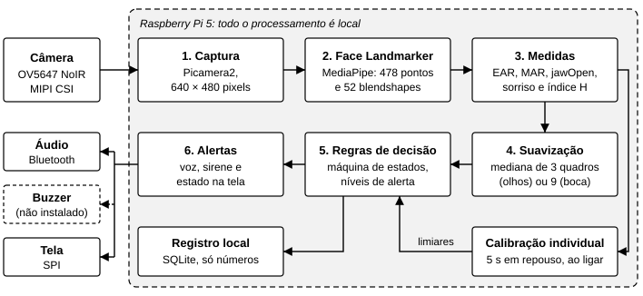

# 3 METODOLOGIA

Este trabalho caracteriza-se como pesquisa aplicada, com desenvolvimento de um protótipo funcional e avaliação experimental. O sistema foi construído em ciclos curtos: cada regra de decisão era implementada, testada ao vivo pelos próprios autores diante da câmera, medida em uma base pública de vídeos e, quando necessário, ajustada. Para que um ajuste não melhorasse um caso piorando outro, toda mudança passou por testes automatizados e por uma verificação de regressão, descritos na Seção 3.7. O código foi mantido sob controle de versão, e cada parâmetro numérico do sistema traz, no próprio código-fonte, o registro do motivo de seu valor.

## 3.1 Hardware e software

O protótipo é formado por um Raspberry Pi 5 com 4 GB de memória; um módulo de câmera com sensor OmniVision OV5647 de 5 megapixels, conectado à interface MIPI, sem filtro de infravermelho e com dois LEDs infravermelhos que se acendem automaticamente quando a luz ambiente diminui, recurso usado para contornar o desempenho ruim das câmeras comuns à noite²⁰; um dispositivo de áudio Bluetooth, fone de ouvido ou caixa de som, para os alertas sonoros; uma tela sensível ao toque ligada ao barramento SPI; e um *buzzer* ativo, ligado ao pino GPIO26, que serve de alarme de reserva. A Figura 1 apresenta a arquitetura do sistema, com as etapas numeradas na ordem em que cada quadro as percorre.

::: Figura 1: arquitetura do sistema

::: Fonte: autoria própria

O software foi escrito em Python 3.13 sobre o Raspberry Pi OS, baseado no Debian 13. A captura usa a biblioteca Picamera2, que fornece dois fluxos simultâneos do sensor: um na maior resolução disponível, usado para exibição e registro de evidências, e outro de 640 × 480 pixels, usado na inferência. Ao vivo, o sensor opera no modo de 1296 × 972 pixels, que cobre o campo de visão inteiro, travado em 30 quadros por segundo, a mesma taxa dos vídeos da base usada na avaliação (Seção 3.7), e as duas imagens de cada instante são extraídas do mesmo quadro. A estimativa dos marcos faciais é feita pelo *Face Landmarker* do MediaPipe (versão 1.0.1, modelo de precisão float16)¹⁵, e o processamento de imagem e as métricas usam OpenCV e NumPy. As mensagens de voz foram geradas previamente pelo sintetizador de voz Kokoro, com voz em português do Brasil, e ficam armazenadas como arquivos de áudio; o sintetizador Piper atua como reserva, gerando a fala no momento caso algum arquivo falte. O áudio é reproduzido pelo servidor de som PipeWire, e os dados de cada sessão são gravados em um banco SQLite local. Nenhum componente depende de conexão com a internet.

## 3.2 Processamento de cada quadro

A cada quadro capturado, a imagem de 640 × 480 pixels é enviada ao *Face Landmarker* em modo de vídeo, configurado para detectar até três rostos, com confiança mínima de 0,5 para detecção e para rastreamento. Quando há mais de um rosto, como um passageiro no banco de trás, o sistema escolhe como motorista o de maior área na imagem, por estar mais próximo da câmera. Do rosto escolhido são extraídas as seguintes medidas:

- o EAR de cada olho, pela Equação 1, com os pontos 33, 160, 158, 133, 153 e 144 da malha (olho direito) e 362, 385, 387, 263, 373 e 380 (olho esquerdo);
- o MAR, pela Equação 3, com os pontos 61, 82, 312, 291, 317 e 87 do contorno interno dos lábios;
- os coeficientes *jawOpen* (abertura da mandíbula) e *mouthSmileLeft* e *mouthSmileRight* (sorriso), entre os *blendshapes* devolvidos pelo modelo;
- um índice de queda da cabeça, descrito a seguir.

O índice de queda da cabeça *H* é a altura da ponta do nariz abaixo da linha dos olhos, normalizada pela distância entre os olhos, conforme a Equação 4, em que *y*~nariz~ é a coordenada vertical da ponta do nariz, *ȳ*~olhos~ é a média vertical dos doze pontos dos olhos e *d*~io~ é a distância tridimensional entre os centros dos dois olhos.

$$ *H* = (*y*~nariz~ − *ȳ*~olhos~) / *d*~io~ | (4)

Quando a cabeça pende para a frente, o nariz, que fica à frente do plano dos olhos, desce na imagem proporcionalmente mais que eles, e *H* aumenta. A divisão por *d*~io~ torna o índice independente da distância até a câmera, e o uso da distância em três dimensões, com a profundidade estimada pelo modelo, evita que o índice cresça artificialmente quando a câmera está de lado ou a cabeça se inclina para o ombro. Uma primeira versão, baseada na decomposição da matriz de transformação facial do MediaPipe, foi descartada após testes ao vivo: reagia pouco a um cabeceio real e variava muito com oclusões, como a mão perto do rosto.

As medidas brutas oscilam de um quadro para outro por ruído de rastreamento. Por isso, o EAR de cada olho é suavizado pela mediana dos três últimos quadros, e o MAR e o *jawOpen* pela mediana dos nove últimos, janela maior porque o rastreamento dos lábios fica instável com a boca muito aberta. O tempo usado em todas as regras é o tempo do fluxo de vídeo, e não o tempo de processamento: na câmera, é o relógio do sistema; em um arquivo de vídeo, é a posição do quadro. Assim, um vídeo gravado é avaliado exatamente como seria ao vivo, o que permite usar a mesma implementação na avaliação com a base pública.

## 3.3 Calibração individual

Como o EAR de olho aberto, a abertura da boca em repouso e a posição natural da cabeça variam de pessoa para pessoa¹⁹, os limiares do sistema não são fixos: são derivados de uma calibração feita sempre que o sistema é ligado. A calibração nunca é reaproveitada de uma sessão anterior, porque a iluminação, o ângulo de montagem da câmera e a postura do condutor mudam de um dia para outro.

Ao ligar, o sistema primeiro espera que o rosto do condutor apareça na câmera, com os dois olhos visíveis por um segundo seguido; se ninguém aparecer em dois segundos, avisa por voz que está aguardando o motorista. Essa espera evita calibrar o banco vazio quando o equipamento é ligado antes de o condutor se sentar. Em seguida, uma mensagem de voz avisa que a calibração começará em três segundos e pede que o condutor se sente como se estivesse dirigindo. Em seguida, o sistema coleta cinco segundos de quadros com o rosto em repouso. Quadros com a boca ou a mandíbula abertas, como os de quem fala ou boceja nesse momento, são descartados, e a coleta se estende automaticamente, até o máximo de dez segundos, para completar os cinco segundos válidos. Um bocejo ocorrido durante a calibração não é ignorado: ele entra na contagem de bocejos da sessão, já que quem boceja ao ligar o sistema já está cansado. A referência de cada medida é a mediana dos quadros válidos, exigindo-se no mínimo 20 amostras.

Duas verificações protegem contra uma calibração ruim. A primeira exige que o EAR de referência fique entre 0,15 e 0,45, faixa fora da qual a medida indica rosto mal detectado. A segunda compara o EAR obtido com a mediana das últimas dez calibrações bem-sucedidas: um desvio superior a 20%, geralmente causado por olhos arregalados ou postura incomum, faz o sistema explicar o problema por voz e repetir a calibração, em até três tentativas. Na última tentativa, um EAR diferente do histórico é aceito, pois pode tratar-se simplesmente de outro condutor; apenas se os olhos não forem encontrados o sistema passa a usar limiares padrão, avisando o condutor por voz. O Quadro 1 resume como cada limiar é derivado das referências calibradas.

::: Quadro 1: limiares derivados da calibração

| Grandeza | Regra de decisão | Sem calibração |
|---|---|---|
| Olho fechado | EAR < 0,70 × EAR de referência | EAR < 0,21 |
| Olho semicerrado | EAR < 0,85 × EAR de referência | EAR < 0,26 |
| Olho fechado para o PERCLOS | EAR < 0,50 × EAR de referência | EAR < 0,15 |
| Bocejo pelos lábios (pico) | MAR > maior valor entre 2,2 × MAR de referência e 0,55 | MAR > 0,55 |
| Bocejo pelos lábios (sustentação) | MAR > 0,73 × limiar de pico | MAR > 0,40 |
| Bocejo pela mandíbula | *jawOpen* com pico > 0,60, sustentado > 0,40 | igual |
| Cabeça baixa | *H* > *H* de referência + 0,15 | desativado |
| Sorriso | *mouthSmile* > valor neutro + 0,25 | desativado |

::: Fonte: autoria própria

Para o PERCLOS foi adotado um limiar mais rigoroso que o do alarme, mais próximo do critério P80 da literatura⁹: o alarme precisa reconhecer cedo um olho que se fecha, enquanto o PERCLOS, se usasse o mesmo limiar, acumularia olhos apenas apertados, como os de quem olha para o painel. A detecção de cabeça baixa fica desativada sem calibração porque a posição neutra da cabeça depende do ângulo de montagem da câmera e não admite um valor padrão confiável.

## 3.4 Regras de decisão

A decisão é tomada por uma máquina de estados que classifica cada quadro em um de quatro níveis: aberto, atenção, fechando e fechado. O estado dos olhos tem prioridade; os demais sinais só elevam o nível quando os olhos estão abertos.

O alarme de sono, nível fechado, dispara quando os dois olhos permanecem abaixo do limiar de olho fechado por 1,5 segundo contínuo. Esse tempo sobe para 2,5 segundos quando o condutor está falando ou sorrindo, situações em que a musculatura do rosto está contraída, o oposto do relaxamento do cochilo, e nas quais os olhos se fecham por instantes ao rir. A fala é reconhecida quando o MAR bruto cruza o valor de 0,12 para cima pelo menos duas vezes em três segundos, e o sorriso quando o coeficiente de sorriso supera em 0,25 o valor neutro da calibração. Um fechamento que dura entre 0,5 segundo e o tempo do alarme é contado como piscada longa, e três piscadas longas em dois minutos elevam o nível para atenção. O PERCLOS é calculado em uma janela deslizante de 60 segundos e eleva o nível para atenção quando atinge 15%, desde que a janela já tenha ao menos 30 segundos de dados.

O bocejo é detectado por dois caminhos independentes, ambos com histerese: um episódio começa quando a medida ultrapassa o limiar de sustentação, termina quando volta a ficar abaixo dele e só é contado se, em algum momento, atingir o limiar de pico. Pelos lábios, o episódio precisa durar ao menos 0,8 segundo; pela mandíbula, que também se move durante a fala, ao menos 2,0 segundos. O segundo caminho existe para os bocejos de boca coberta pela mão ou de lábios pouco abertos, em que o MAR quase não sobe. Registros dos dois caminhos separados por menos de cinco segundos são tratados como um único bocejo, e lacunas de até 0,5 segundo no sinal, típicas de falhas momentâneas de rastreamento, não encerram o episódio. Um bocejo em andamento há 1,5 segundo pelos lábios ou há 2,0 segundos pela mandíbula, ou três bocejos em cinco minutos, geram um aviso de fadiga, que nunca escala para o alarme de sono. Pelo mesmo motivo, olhos fechados durante um bocejo, ou até dois segundos depois dele, são atribuídos ao bocejo: não disparam o alarme de sono e não entram no cálculo do PERCLOS.

A queda da cabeça é contada quando o índice *H* fica acima do limiar por pelo menos um segundo, tolerando oscilações de até 0,5 segundo, e somente se, ao mesmo tempo, os olhos estiverem semicerrados ou fechados. Essa exigência distingue o cochilo, em que a cabeça pende enquanto os olhos se fecham, do condutor que apenas olha para o painel ou para o rádio. Como uma queda real costuma tirar o rosto do campo da câmera, o desaparecimento do rosto até um segundo após um quadro de cabeça baixa com olhos se fechando também conta como queda. Uma queda sustentada, ou duas quedas em dois minutos, elevam o nível para atenção.

O uso de óculos escuros não recebe tratamento à parte: a decisão continua baseada no EAR, e o cenário 8 do protocolo de testes (Seção 3.6) verifica se o olho fechado continua sendo detectado através da lente. Uma versão anterior do sistema deixava de considerar o EAR quando a região dos olhos ficava escura em relação ao resto do rosto; ela foi removida pelos motivos discutidos na Seção 4.2. A condição adversa que recebe tratamento próprio é a ausência do rosto: falhas de até 0,5 segundo são toleradas sem perder o estado; após três segundos sem rosto, depois de ele já ter sido visto, o sistema considera que o condutor desviou o olhar da via (a 80 km/h, cerca de 67 metros percorridos) e emite um aviso de distração, até o limite de 60 segundos, a partir do qual assume que o condutor deixou o banco.

## 3.5 Alertas sonoros e registro

Cada categoria de sinal tem um alerta próprio, com mensagem de voz distinta, para que o condutor reconheça a gravidade sem olhar para a tela. O Quadro 2 apresenta a hierarquia.

::: Quadro 2: hierarquia de alertas

| Alerta | Sinais que o disparam | Mensagem | Repetição |
|---|---|---|---|
| Alarme de sono | olhos fechados por 1,5 s (2,5 s falando ou sorrindo) | "Acorde! Sinais de sonolência detectados! Pare o veículo!", com sirene ao fundo | toca sempre até o fim e repete enquanto o estado durar |
| Atenção | piscadas longas frequentes, PERCLOS elevado, queda da cabeça | "Atenção! Sinais de sono detectados." | intervalo mínimo de 10 s |
| Fadiga | bocejo | "Sinal de fadiga ou cansaço." | intervalo mínimo de 10 s; nunca escala |
| Distração | rosto ausente por 3 s | "Atenção! Olhe para a estrada." | intervalo mínimo de 6 s |

::: Fonte: autoria própria

O alarme de sono, uma vez iniciado, toca até o fim mesmo que os olhos se reabram no meio da reprodução. A decisão foi tomada após um teste ao vivo: interromper o som no instante em que o olho se abre permitia silenciar o alarme com uma piscada, sem que o condutor estivesse de fato desperto. Os alertas tocam no dispositivo de áudio Bluetooth, e um monitor verifica a cada três segundos se ele continua sendo a saída de som ativa. Se ele se desconectar, por bateria ou alcance, o sistema avisa por voz na saída seguinte e passa a acionar também o *buzzer* de reserva, por oito segundos, junto com o alarme de sono e o aviso de distração.

Durante o monitoramento, o sistema grava no banco SQLite, quadro a quadro, apenas valores numéricos: EAR, MAR, índice da cabeça, PERCLOS, contagens de eventos, nível de alerta e tempo de processamento. Para servir de evidência na avaliação, o quadro do instante de cada alarme de sono é salvo como imagem no próprio dispositivo; essas imagens nunca saem dele e ficam fora do controle de versão, por constituírem dado biométrico nos termos da LGPD¹⁴.

## 3.6 Protocolo de testes guiados

Para validar o sistema com o próprio condutor, foi criado um modo de autoteste guiado por voz, que conduz oito cenários controlados, um de cada vez, e avalia cada um automaticamente pelo critério do Quadro 3. Ao final, gera um relatório com o resultado e com a telemetria de cada cenário (valores mínimos e máximos de EAR, MAR e índice da cabeça, tempo de cabeça baixa e tempo sem rosto), o que permite diagnosticar uma falha sem repetir o teste. O mesmo modo serve de demonstração do funcionamento do sistema. Os testes foram realizados pelos próprios autores, sem participação de terceiros.

::: Quadro 3: cenários do protocolo de testes guiados

| Cenário | Instrução dada por voz | Critério de aprovação |
|---|---|---|
| 1. Linha de base | ficar parado, olhando para a frente, por 15 s | nenhum alarme e nenhuma piscada longa |
| 2. Piscada normal | piscar normalmente por 10 s | nenhuma piscada longa contada |
| 3. Piscada longa | fechar os olhos por quase 1 s | piscada longa contada, sem alarme de sono |
| 4. Microssono | fechar os olhos por 2 s ou mais | alarme de sono disparado |
| 5. Fala normal | falar naturalmente por 15 s | nenhum bocejo contado |
| 6. Bocejo real | bocejar, podendo fechar os olhos | bocejo contado, sem alarme de sono |
| 7. Cabeça caindo | fechar os olhos e deixar a cabeça pender por 2 s | queda da cabeça contada |
| 8. Óculos | com óculos escuros ou polarizados, olhar 5 s e fechar os olhos por 3 s | alarme de sono disparado |

::: Fonte: autoria própria

O cenário 8 tem o mesmo critério do microssono porque os óculos não mudam o que o sistema precisa fazer: se o condutor fecha os olhos, o alarme de sono deve disparar, com ou sem lente.

## 3.7 Avaliação em bases públicas, testes automatizados e desempenho

A avaliação com uma população maior que a dos autores foi feita na base YawDD²¹, cujos vídeos têm resolução de 640 × 480 pixels a 30 quadros por segundo e foram gravados em um veículo, com iluminação real e variável, por participantes de ambos os sexos, com e sem óculos. A base tem dois conjuntos. No conjunto Mirror, com a câmera sob o retrovisor, cada participante aparece em três ou quatro vídeos separados: dirigindo em silêncio, falando ou cantando, e bocejando. Foram usados os 320 vídeos disponíveis desse conjunto, de 90 participantes (115 de bocejo, 100 de fala e 105 de condução normal). No conjunto Dash, com a câmera no painel, cada um dos 29 participantes aparece em um único vídeo com todos os comportamentos. No total, são 349 vídeos e cerca de 2,7 horas de gravação.

Cada vídeo é processado com o mesmo código do programa ao vivo: os primeiros segundos servem de calibração, como ao ligar o sistema no carro, e as mesmas regras e limiares são aplicados ao restante. Como a base rotula cada vídeo e não cada instante, a avaliação de bocejo no conjunto Mirror é feita por vídeo: um vídeo de bocejo é acerto se ao menos um bocejo for contado, e um vídeo de fala ou de condução normal é falso positivo se algum bocejo for contado. Daí resultam a sensibilidade (*recall*), a precisão e a medida F1. No conjunto Dash, sem marcação de tempo, mede-se a proporção de vídeos em que o bocejo é encontrado. Como nenhum participante da base está de fato sonolento, todo alarme de sono e todo aviso de atenção emitidos são contados como alarmes falsos, expressos por hora de gravação. A avaliação ocorre em duas fases: na primeira, o MediaPipe é executado uma única vez por vídeo e as medidas de cada quadro são salvas; na segunda, a calibração e as regras são reaplicadas sobre essas medidas, o que permite reavaliar os 349 vídeos em segundos após cada ajuste. Nenhuma imagem dos participantes é armazenada.

Como parte dos limiares de bocejo foi ajustada observando os próprios vídeos da YawDD, o resultado nesses vídeos tende a ser otimista. Para estimar o desempenho em pessoas que o ajuste não viu, foi feita uma validação cruzada por participante em cinco dobras: os participantes são divididos em cinco grupos, mantendo todos os vídeos de uma mesma pessoa no mesmo grupo; para cada grupo, os quatro parâmetros do bocejo são escolhidos, entre 81 combinações, usando apenas os outros quatro grupos, e o desempenho é medido no grupo deixado de fora.

Como nenhum participante da YawDD está sonolento, a resposta do sistema à sonolência real foi avaliada na base UTA-RLDD (*UTA Real-Life Drowsiness Dataset*)²⁸, na qual 60 participantes gravaram a si mesmos, com o próprio celular ou *webcam*, em três estados, por cerca de dez minutos em cada: alerta, pouco vigilante e sonolento. O estado de cada vídeo foi atribuído pelo próprio participante com a Escala de Sonolência de Karolinska (KSS)²⁹: alerta corresponde aos níveis 1 a 3 da escala, e sonolento, aos níveis 8 e 9, em que é preciso esforço para se manter acordado. Por limite de volume de download do serviço que hospeda a base, foram usados os vídeos alerta e sonolento dos 54 primeiros participantes, na ordem das dobras definidas pelos autores, exceto dois que não têm vídeo sonolento na base: 52 participantes, num total de 104 vídeos e 18,0 horas de gravação, com resoluções de 240 × 426 a 1440 × 2560 pixels e taxas de 12 a 30 quadros por segundo. Os vídeos passaram pelo mesmo processamento da YawDD, com a imagem reduzida sem alterar sua proporção, e cada vídeo foi apagado logo após a extração das medidas.

Como a base rotula o vídeo inteiro e não cada instante, a análise compara, para cada participante, o vídeo alerta com o sonolento, em dois níveis. No primeiro, as medidas do olho são calculadas diretamente da série do EAR, suavizada como no sistema e tendo como referência a mediana do EAR do próprio vídeo: cada trecho com EAR abaixo de 70% da referência conta como um fechamento, e dele se obtêm a duração média das piscadas e o seu percentil 90, a proporção de piscadas de 0,5 segundo ou mais, o número de fechamentos de um segundo ou mais por hora e a frequência de piscadas, além do PERCLOS do vídeo inteiro, com o limiar de 50% da referência usado pelo sistema. No segundo nível, o sistema completo é aplicado ao vídeo e contam-se, por hora, as piscadas longas, os avisos de atenção, os alarmes de sono, os bocejos e as quedas de cabeça. O vídeo sonolento é avaliado de duas formas: com a calibração feita nos primeiros segundos do próprio vídeo, como se o sistema fosse ligado com o condutor já sonolento, e com a calibração obtida no vídeo alerta da mesma pessoa, situação de quem liga o sistema descansado e fica sonolento ao longo da viagem. A diferença entre os dois estados é avaliada pelo teste exato dos postos sinalizados de Wilcoxon³⁰, bilateral, adequado a amostras pareadas pequenas por não supor distribuição normal; os participantes com o mesmo valor nos dois vídeos são excluídos do teste, como o método prevê.

A lógica de decisão e o preparo da imagem são cobertos por 46 testes automatizados, escritos com a biblioteca pytest. A maior parte alimenta a máquina de estados com sequências sintéticas de medidas e verifica o comportamento esperado em cada situação, como a piscada longa, o bocejo de olhos fechados e a queda da cabeça que tira o rosto do quadro. Complementarmente, um teste de regressão reaplica as regras atuais aos 349 vídeos da YawDD e aos 86 episódios de alarme de sono registrados nas sessões ao vivo durante o desenvolvimento, e acusa qualquer piora em relação a uma referência salva. Esse segundo conjunto protege contra uma regra nova que reduza alarmes falsos à custa de esconder um fechamento de olhos real.

Por fim, o desempenho na plataforma-alvo foi medido por uma ferramenta própria, que processa um vídeo da YawDD na maior velocidade possível e registra, quadro a quadro, o tempo gasto apenas pelo MediaPipe e o tempo total do quadro até a decisão, com média, mediana e percentis de 95% e 99%. A cada dez segundos são registrados também a taxa de quadros, o uso de processador, a temperatura, a frequência de operação do processador e o registro de subtensão e de redução de velocidade do Raspberry Pi. Além de uma medição curta, foi realizado um teste de resistência de 20 minutos contínuos, que repete o vídeo para verificar se o desempenho se mantém com o aquecimento da placa.

# REFERÊNCIAS BIBLIOGRÁFICAS

> Referências citadas pela primeira vez neste capítulo. A numeração continua a do Capítulo 2 (16 a 27); na montagem do PDF, todas formam uma única lista ao final do texto.

28. GHODDOOSIAN, Reza; GALIB, Marnim; ATHITSOS, Vassilis. A realistic dataset and baseline temporal model for early drowsiness detection. In: **IEEE/CVF Conference on Computer Vision and Pattern Recognition Workshops (CVPRW)**, 2019, Long Beach. Anais [...]. Piscataway: IEEE, 2019. p. 178–187. DOI: https://doi.org/10.1109/CVPRW.2019.00027.

29. ÅKERSTEDT, Torbjörn; GILLBERG, Mats. Subjective and objective sleepiness in the active individual. **International Journal of Neuroscience**, v. 52, n. 1–2, p. 29–37, 1990. DOI: https://doi.org/10.3109/00207459008994241.

30. WILCOXON, Frank. Individual comparisons by ranking methods. **Biometrics Bulletin**, v. 1, n. 6, p. 80–83, 1945. DOI: https://doi.org/10.2307/3001968.

---

## Observações para revisão (não fazem parte do texto)

- **Tamanho:** cerca de 3.000 palavras de texto e três quadros, contra 1.790 palavras e sete figuras no Cap. 3 do TCC-modelo. Dá para enxugar se o orientador achar longo; o mais fácil de cortar é o detalhamento das condições adversas (Seção 3.4, último parágrafo).
- **Referências novas (05/11/2026):** 28 (UTA-RLDD), 29 (KSS) e 30 (Wilcoxon), conferidas na Crossref (autores, título, veículo, páginas e DOI). As demais citadas aqui já estavam listadas (9, 14, 15, 19 e 21).
- **UTA-RLDD (Seção 3.7):** números de 10/11/2026 (52 participantes: pessoas 1 a 54, sem a 32 e a 49, que só têm vídeo alerta na base). A medição das pessoas 55 a 60 está rodando; quando terminar, atualizar "54 primeiros", "52 participantes", "104 vídeos", "18,0 horas", resoluções e taxas de quadros, junto com a Seção 4.5 (se as 60 entrarem, a frase do limite de download sai). Os níveis da KSS de cada classe foram conferidos no artigo da base (níveis 4 e 5 não pertencem a nenhuma classe).
- **Conferido no código em 20/10/2026** (`core.py`, `eye_fatigue.py`, `gerar_vozes.py`, `avaliar_yawdd.py`, `validacao_cruzada.py`, `benchmark.py`): todos os números do texto e dos quadros. Se algum limiar mudar no código, o Quadro 1 e a Seção 3.4 precisam mudar junto.
- **Figura 1:** diagrama de blocos em `figuras/figura1_arquitetura.svg` (vetorial, embutido no HTML e no PDF; para colar no Google Docs há uma cópia em PNG na Área de Trabalho, "TCC - Figura 1.png"). Outras figuras úteis: foto da montagem no carro, captura da tela com os pontos no rosto (rosto do autor, com autorização dele) e o gráfico do EAR numa piscada longa.
- **A confirmar com os autores:** modelo exato do fone (Lenovo ThinkPlus GM2 Pro) e tamanho da tela SPI.
- **Ainda não usado aqui:** `core.realcar_pouca_luz` (realce de contraste com pouca luz) existe no código mas não está ligado no processamento; fica para trabalhos futuros no Cap. 5.
- **Custo dos componentes (levantado em 10/11/2026, preço de loja no cartão):** Raspberry Pi 5 4 GB R$ 1.574,90 (RoboCore, esgotado); tela 3,5" R$ 203,76 (UsinaInfo); câmera OV5647 com LEDs IR R$ 155,52 (UsinaInfo); fonte 27 W R$ 116,82; microSD 32 GB R$ 113,40; cooler ativo R$ 49,90; cabo da câmera R$ 15,00 (RoboCore); buzzer R$ 4,32 (UsinaInfo). Total R$ 2.233,62, com links na pergunta "Quanto custa o sistema?" do doc da apresentação. Ainda NÃO está no texto: conferir com o que foi pago. Sugestão para o fim do 1º parágrafo da 3.1: "Em novembro de 2026, esses componentes custavam cerca de R$ 2.230 no varejo brasileiro, dos quais cerca de 70% correspondiam à placa."
