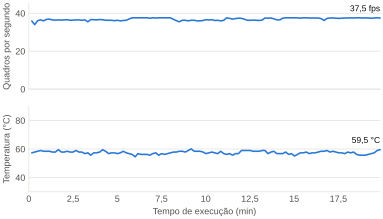

# 4 RESULTADOS E DISCUSSÃO

Este capítulo apresenta os resultados das quatro frentes de avaliação descritas na Seção 3.7: os testes automatizados, o protocolo de testes guiados, a avaliação na base YawDD, com a validação cruzada por participante, e a medição de desempenho no Raspberry Pi 5. Ao final, discutem-se as limitações identificadas.

## 4.1 Testes automatizados e regressão

Os 42 testes automatizados da lógica de decisão foram aprovados na versão final do sistema. Cada um deles corresponde a um comportamento verificado ao longo do desenvolvimento, muitas vezes a partir de uma falha real: o bocejo com os olhos fechados que não pode disparar o alarme de sono, a queda da cabeça que tira o rosto do quadro e ainda assim deve ser contada, a fala e o sorriso que estendem o tempo do alarme. O teste de regressão, executado sobre as séries da rodada final do YawDD e sobre os 80 episódios de alarme registrados nas sessões ao vivo, [[PENDENTE: resultado do verificar_regressao.py da fila]].

## 4.2 Protocolo de testes guiados

O protocolo de oito cenários foi executado doze vezes durante o desenvolvimento, entre 9 e 30 de setembro de 2026, e uma última vez na versão final. A Figura 2 mostra o número de cenários aprovados em cada rodada.

::: Figura 2: cenários aprovados em cada rodada do protocolo de testes guiados

::: Fonte: autoria própria

A evolução não foi monotônica, e as quedas foram tão informativas quanto os avanços. Nas primeiras rodadas, de 9 de setembro, falharam a fala, confundida com bocejo, o microssono, cujo limiar de olho fechado se mostrou rígido demais, e o bocejo real, cujo rastreamento dos lábios falhava por instantes no meio do movimento, interrompendo a contagem. Esses problemas levaram, respectivamente, à exigência de um pico de abertura bem maior que o da fala, ao afrouxamento do limiar de olho fechado e à tolerância a lacunas de rastreamento, com mediana de nove quadros na boca.

A queda para 4 de 8 cenários em 23 de setembro, às 12h19, não decorreu de mudança no código: a calibração daquela rodada registrou EAR de referência de 0,320, contra cerca de 0,24 nas demais, provavelmente por olhos arregalados durante a coleta. Com uma referência inflada, o limiar de olho fechado subiu e piscadas normais passaram a ser contadas como longas. O episódio motivou a comparação de cada calibração com o histórico das anteriores, descrita na Seção 3.3. Já as falhas do cenário da cabeça em 30 de setembro foram diagnosticadas pela telemetria do relatório. Na primeira, uma oscilação de um único quadro reiniciava a contagem da queda, corrigida com a tolerância de 0,5 segundo; na segunda, a queda real tirava o rosto do quadro após 0,3 segundo visível, antes de completar o tempo mínimo. A regra que conta como queda o desaparecimento do rosto logo após a cabeça baixar com os olhos se fechando resolveu o caso, e a rodada seguinte aprovou os oito cenários pela primeira vez.

O cenário dos óculos exigiu uma decisão de projeto. Os únicos óculos escuros disponíveis para o teste tinham lente polarizada, com razão de brilho entre olhos e rosto de 0,60 a 0,67, próxima do limiar de 0,70 e insuficiente para sustentar o modo de óculos por três segundos. Em vez de afrouxar o limiar até o caso de teste passar, o critério do cenário foi redefinido para o comportamento que de fato importa (Quadro 3): o sistema não pode ficar cego sem perceber. Nas rodadas de 30 de setembro, o EAR medido através da lente polarizada caiu para 0,07 a 0,11 com os olhos fechados, bem abaixo do limiar de olho fechado, ou seja, a lente não impediu a detecção. [[PENDENTE: resultado da rodada final do autoteste de 20/10, com a telemetria relevante.]]

## 4.3 Avaliação na base YawDD

A rodada final processou os 349 vídeos da base, com [[PENDENTE: calibração válida em X de 349 e rosto detectado em Y% dos quadros]]. O Quadro 4 compara os resultados da versão inicial do sistema, avaliada em 26 de setembro, com os da versão final.

::: Quadro 4: resultados na base YawDD, versão inicial e versão final

| Medida | Versão inicial (26/09) | Versão final |
|---|---|---|
| Sensibilidade do bocejo (Mirror) | 46,1% (53 de 115) | [[ ]] |
| Precisão do bocejo (Mirror) | 100,0% | [[ ]] |
| Medida F1 do bocejo (Mirror) | 63,1% | [[ ]] |
| Bocejo falso em vídeos de fala ou de condução normal | 0 de 205 | [[ ]] |
| Vídeos do Dash com bocejo encontrado | 15 de 29 | [[ ]] |
| Alarmes de sono (todos falsos) | 76 (28,5 por hora) | [[ ]] |
| Avisos de atenção (todos falsos) | 219 (82,1 por hora) | [[ ]] |

::: Fonte: autoria própria

A versão inicial era conservadora na direção errada para o bocejo: não inventava bocejos, com precisão de 100%, mas deixava passar mais da metade deles, e ao mesmo tempo emitia alarmes de sono e avisos de atenção em pessoas que não estavam sonolentas. A análise dos vídeos com erro mostrou causas recorrentes, e cada ajuste descrito no Capítulo 3 responde a uma delas. Bocejos de pico baixo passavam poucos décimos de segundo acima do limiar único de abertura e nunca completavam a duração mínima, o que motivou a histerese entre pico e sustentação. Bocejos com os lábios pouco abertos ou cobertos pela mão quase não alteravam o MAR, o que motivou o segundo caminho, pela mandíbula. Parte das participantes bocejava logo no início do vídeo, dentro da calibração, contaminando a referência, o que motivou o descarte dos quadros de boca aberta. Do lado dos alarmes falsos, os olhos se fechavam ao rir e falar, ao bocejar e logo depois dele, e a cabeça baixava quando o condutor olhava para o painel, situações tratadas pelas regras de fala, sorriso, bocejo e cabeça com olhos se fechando.

::: Figura 3: sensibilidade na detecção de bocejo por grupo de participantes

::: Fonte: autoria própria

A Figura 3 detalha a sensibilidade por grupo. [[PENDENTE: comentar os grupos com os números finais; na prévia de 30/09, mulheres e óculos escuros ficavam abaixo da média.]] Os bocejos ainda não detectados concentram-se em casos em que nem os lábios nem a mandíbula se movem o suficiente, como bocejos contidos ou cobertos pela mão, situação que está no limite do que os marcos faciais conseguem observar.

Como os vídeos da YawDD são curtos, com um a dois minutos, as regras baseadas em frequência, como as três piscadas longas em dois minutos e o PERCLOS em janela de 60 segundos com ao menos 30 segundos de histórico, têm pouco tempo para agir. Os alarmes falsos medidos na base refletem, portanto, sobretudo as regras instantâneas.

## 4.4 Validação cruzada por participante

[[PENDENTE: resultado do validacao_cruzada.py: sensibilidade e taxa de falso positivo por dobra e no conjunto, comparadas com o resultado da regra final sobre a base inteira. A diferença entre os dois é a estimativa do otimismo causado pelo ajuste na própria base.]]

## 4.5 Desempenho no Raspberry Pi 5

[[PENDENTE: Quadro 5 com os números do teste de resistência de 60 min (FPS médio, tempo por quadro médio/p95/p99, só MediaPipe e quadro completo, CPU, temperatura inicial/máxima/final, frequência mínima) e a Figura 4.]]

::: Figura 4: taxa de quadros e temperatura no teste de resistência de 60 minutos

::: Fonte: autoria própria

Em uma medição curta anterior, de 30 de setembro, o sistema processou 36,3 quadros por segundo, com 25,0 ms em média por quadro completo, dos quais 23,6 ms correspondem ao MediaPipe, e percentil de 95% de 26,5 ms, com o processador a 2,4 GHz e temperatura máxima de 54,5 °C. O processamento, portanto, não é o gargalo do sistema: ao vivo, a taxa é limitada pela câmera, que no modo de resolução máxima, escolhido para registrar evidências com detalhe, entrega 15,6 quadros por segundo, menos da metade da capacidade medida. Nessa taxa, a mediana de três quadros usada na suavização do EAR acrescenta cerca de um quadro (64 ms) ao tempo de 1,5 segundo exigido para o alarme de sono, e o processamento de cada quadro, outras poucas dezenas de milissegundos, atrasos desprezíveis diante do tempo de reação humano. Um modo de menor resolução do mesmo sensor, como 1296 × 972 pixels a 46 quadros por segundo, permitiria aproveitar toda a capacidade de processamento, ao custo de imagens de registro menos detalhadas.

O registro de energia do Raspberry Pi, no entanto, indicou subtensão e redução de velocidade desde a inicialização. A placa exige fonte de 5 V e até 5 A²⁵, e a fonte usada no desenvolvimento não atendia plenamente a essa especificação. Embora a frequência do processador tenha permanecido em 2,4 GHz durante as medições, a instalação no veículo requer uma fonte dimensionada para a placa, já que a tensão de um sistema automotivo varia com a partida do motor e com a carga elétrica.

## 4.6 Limitações

Os resultados devem ser lidos à luz de algumas limitações. A primeira, e mais importante, é que nenhuma das avaliações envolveu sonolência real: no protocolo guiado, os autores simularam os fechamentos de olhos, os bocejos e as quedas de cabeça, e na YawDD os participantes estavam despertos. A detecção de microssono foi validada, portanto, pelo comportamento do sistema diante de fechamentos simulados com a duração característica, e não por episódios espontâneos. A validação com condutores efetivamente sonolentos exigiria uma base como a NTHU-DDD, cujo acesso depende de termo assinado pela instituição, ou um protocolo próprio de privação de sono, com aprovação de comitê de ética.

A segunda limitação é a iluminação. A câmera utilizada não enxerga no infravermelho, o que restringe o uso noturno, justamente o período de maior risco segundo os dados da PRF³. Lentes escuras, por sua vez, impedem a medição do EAR, e nesse caso o sistema depende apenas da boca e da cabeça. A solução prevista é uma câmera sem filtro infravermelho com iluminação ativa em 850 nm, recurso empregado para contornar a limitação noturna dos sistemas baseados em câmera²⁰; seu comportamento diante de lentes escuras ainda precisa ser verificado.

A terceira refere-se aos parâmetros do bocejo, ajustados com a própria base em que foram medidos, limitação mitigada pela validação cruzada por participante (Seção 4.4), mas que só será eliminada com uma base independente. Por fim, os testes ao vivo foram realizados por poucas pessoas, em um único veículo e com uma única posição de câmera; diferenças de montagem, de altura do condutor e de iluminação de outros veículos ainda precisam ser avaliadas.

---

## Observações para revisão (não fazem parte do texto)

- **Rascunho em andamento:** os trechos marcados com `[[...]]` dependem da fila de medições de 20/10 (YawDD completo, regressão, validação cruzada e teste de resistência) e da rodada final do autoteste. Serão preenchidos assim que esses resultados saírem.
- **Figuras 2, 3 e 4:** geradas por `figuras_cap4.py` a partir dos arquivos de resultado; rodar de novo depois de cada medição. A Figura 3 e a Figura 4 ainda mostram dados de prévia (YawDD de 30/09 e benchmark de 1 min de 30/09).
- **Infravermelho e óculos escuros:** a frase da Seção 4.6 só afirma o uso noturno do infravermelho (o que a referência 20 diz); o efeito sobre lentes escuras ficou como algo a verificar, sem citação.
