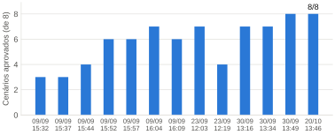
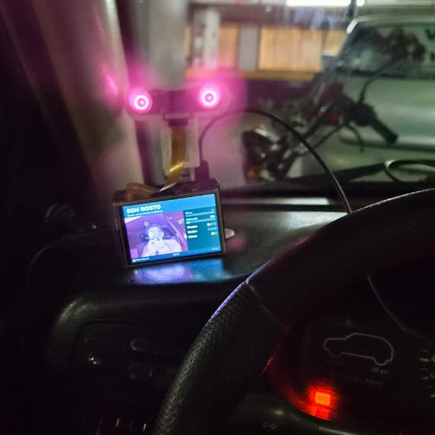
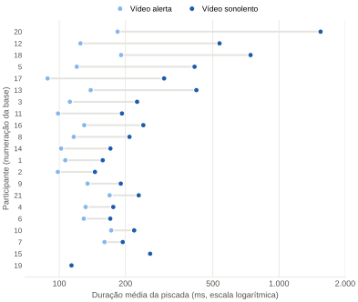

# 4 RESULTADOS E DISCUSSÃO

Este capítulo apresenta os resultados das cinco frentes de avaliação descritas na Seção 3.7: os testes automatizados, o protocolo de testes guiados, a avaliação na base YawDD, com a validação cruzada por participante, a avaliação com sonolência real na base UTA-RLDD e a medição de desempenho no Raspberry Pi 5. Ao final, discutem-se as limitações identificadas.

## 4.1 Testes automatizados e regressão

Os 53 testes automatizados foram aprovados na versão final do sistema: 51 da lógica de decisão e 2 do preparo da imagem, que conferem que vídeos fora da proporção 4:3, como os gravados com o celular em pé, chegam ao MediaPipe sem distorção. Cada teste da lógica de decisão corresponde a um comportamento verificado ao longo do desenvolvimento, muitas vezes a partir de uma falha real: o bocejo com os olhos fechados que não pode disparar o alarme de sono, a queda da cabeça que tira o rosto do quadro e ainda assim deve ser contada, a fala e o sorriso que estendem o tempo do alarme, o olho apertado contra a luz que não pode ser tomado por olho fechado. O teste de regressão, executado sobre as séries da rodada final do YawDD e sobre os 95 episódios de alarme registrados nas sessões ao vivo, não apontou piora no bocejo nem nos alarmes de sono em relação à referência de 30 de setembro. Apenas dois vídeos tiveram contagens de bocejo alteradas, ambos com bocejos a mais em vídeos que já continham bocejo, efeito do reprocessamento das medidas desde o início. Os avisos de atenção falsos caíram de 19 para 17 com a remoção do modo de óculos escuros (Seção 4.2) e para 10 com as duas últimas mudanças: a referência de olho aberto que acompanha a iluminação (Seção 3.3) e os avisos leves que só se repetem com motivo novo (Seção 3.5).

Essas duas mudanças foram também as únicas a reduzir os episódios ao vivo que disparam o alarme. Aplicadas às mesmas sessões, as regras anteriores disparam em 73 dos 95 episódios, e as atuais, em 69. Os quatro que deixaram de disparar vêm de sessões antigas, gravadas a cerca de 7,7 quadros por segundo e com as cores trocadas (Seção 4.6). Em dois, o olho estava apenas apertado, entre 53% e 71% do valor de referência, sem se fechar. No terceiro, os olhos ficaram fechados por cerca de um segundo e reabriram devagar, e a regra anterior contava a reabertura como olho fechado até completar 1,5 segundo; no quarto, um olho ficou fechado por quase dois segundos enquanto o outro permaneceu entre 58% e 69%, e os dois estiveram fechados juntos por cerca de meio segundo. Nenhum deles corresponde ao critério do alarme, os dois olhos fechados por 1,5 segundo. Na sessão em ambiente claro que motivou a referência adaptativa (Seção 3.3), o alarme de sono sem olho fechado deixou de ocorrer, e os avisos sonoros caíram de 12 para 5. Como os episódios ao vivo foram gravados por versões anteriores do sistema, que tinham falhas corrigidas depois, o teste não exige que todos disparem, e sim que nenhuma mudança reduza esse número sem que se saiba por quê.

## 4.2 Protocolo de testes guiados

O protocolo de oito cenários foi executado doze vezes durante o desenvolvimento, entre 9 e 30 de setembro de 2026, uma vez em 20 de outubro, ainda com as duas falhas de captura descritas na Seção 4.6, uma vez em 30 de outubro, já com a captura corrigida, uma vez em 20 de novembro, com a versão final das regras, e duas vezes em 22 de novembro, com a mesma versão, dentro de um carro parado. A Figura 2 mostra o número de cenários aprovados em cada rodada.

::: Figura 2: cenários aprovados em cada rodada do protocolo de testes guiados

::: Fonte: autoria própria

A evolução não foi monotônica, e as quedas foram tão informativas quanto os avanços. Nas primeiras rodadas, de 9 de setembro, falharam a fala, confundida com bocejo, o microssono, cujo limiar de olho fechado se mostrou rígido demais, e o bocejo real, cujo rastreamento dos lábios falhava por instantes no meio do movimento, interrompendo a contagem. Esses problemas levaram, respectivamente, à exigência de um pico de abertura bem maior que o da fala, ao afrouxamento do limiar de olho fechado e à tolerância a lacunas de rastreamento, com mediana de nove quadros na boca.

A queda para 4 de 8 cenários em 23 de setembro, às 12h19, não decorreu de mudança no código: a calibração daquela rodada registrou EAR de referência de 0,320, contra cerca de 0,24 nas demais, provavelmente por olhos arregalados durante a coleta. Com uma referência inflada, o limiar de olho fechado subiu e piscadas normais passaram a ser contadas como longas. O episódio motivou a comparação de cada calibração com o histórico das anteriores, descrita na Seção 3.3. Já as falhas do cenário da cabeça em 30 de setembro foram diagnosticadas pela telemetria do relatório. Na primeira, uma oscilação de um único quadro reiniciava a contagem da queda, corrigida com a tolerância de 0,5 segundo; na segunda, a queda real tirava o rosto do quadro após 0,3 segundo visível, antes de completar o tempo mínimo. A regra que conta como queda o desaparecimento do rosto logo após a cabeça baixar com os olhos se fechando resolveu o caso, e a rodada seguinte aprovou os oito cenários pela primeira vez.

O cenário dos óculos exigiu duas decisões de projeto. A versão inicial tinha um modo de óculos escuros: quando a região dos olhos ficava mais escura que o resto do rosto, com razão de brilho abaixo de 0,70 por três segundos, o sistema deixava de considerar o EAR e passava a depender da boca e da cabeça. Os únicos óculos escuros disponíveis para o teste tinham lente polarizada, com razão de 0,60 a 0,67, insuficiente para sustentar o modo por três segundos. Em vez de afrouxar o limiar até o caso de teste passar, o critério do cenário foi redefinido, naquele momento, para aceitar tanto o olho fechado detectado quanto o modo de óculos ativado, já que o EAR medido através da lente polarizada caía para 0,07 a 0,11 com os olhos fechados, bem abaixo do limiar de olho fechado. A rodada de 30 de outubro mostrou o risco do próprio modo: no cenário do microssono, sem óculos, a razão de brilho chegou a 0,71, a um centésimo do limiar, e o modo teria desligado o EAR justamente durante um olho fechado, a situação que o alarme de sono existe para detectar. Como o EAR continuou medindo o olho através da lente em todas as rodadas com óculos, o modo foi removido, e o cenário 8 passou a exigir o mesmo que o microssono.

Na rodada de 20 de outubro de 2026, os oito cenários foram aprovados, mas o sistema ainda operava a cerca de 7,7 quadros por segundo e com as cores trocadas (Seção 4.6). A rodada de 30 de outubro, a primeira a 30 quadros por segundo e com a cor correta, aprovou sete dos oito cenários. A calibração registrou EAR de referência de 0,269, próximo ao histórico, o que fixou o limiar de olho fechado em 0,188. Na linha de base, o menor EAR observado foi 0,270, acima desse limiar, enquanto no microssono o EAR chegou a 0,020. Na fala, o MAR não passou de 0,358, abaixo do limiar de pico (0,55) que um bocejo precisa atingir para ser contado, e no bocejo real chegou a 0,842. No cenário da cabeça, o índice *H* subiu de 0,36, na calibração, para até 0,88; a queda tirou o rosto do quadro por 3,8 segundos, depois de um segundo de cabeça baixa com olhos se fechando, e foi contada pela regra descrita na Seção 3.4. O cenário dos óculos falhou porque os olhos não foram mantidos fechados pelo tempo pedido: o menor EAR, de 0,036, mostra que as piscadas foram vistas através da lente, mas nenhum fechamento chegou a 1,5 segundo.

A rodada de 20 de novembro, a última antes dos testes no carro, foi executada com a versão final das regras, incluindo a referência de olho aberto que acompanha a iluminação e os avisos que só se repetem com motivo novo (Seções 3.3 e 3.5), e aprovou os oito cenários. A calibração registrou EAR de referência de 0,351, o mais alto entre as rodadas, efeito da luz e da posição naquele dia; como os limiares são proporcionais à referência, o comportamento não se alterou. Na linha de base, o EAR ficou entre 0,355 e 0,381, sem nenhuma piscada longa contada, e no microssono chegou a 0,031. Na fala, o MAR não passou de 0,170, e no bocejo real chegou a 0,823. No cenário da cabeça, o índice *H* subiu de 0,41, na calibração, para até 0,86, e a queda tirou o rosto do quadro por 3,7 segundos. No cenário dos óculos, com a mesma lente polarizada, o EAR caiu para 0,145 com os olhos fechados, abaixo do limiar de olho fechado, de 0,246, e o alarme de sono disparou, o que confirma, com o critério atual, que o olho fechado continua sendo detectado através da lente. Nos cenários aprovados, os valores observados ficaram longe dos limiares de decisão, o que indica que a aprovação não dependeu de casos no limite.

Em 22 de novembro, o protocolo foi executado duas vezes dentro de um carro parado em uma garagem, com a mesma versão das regras. A câmera foi fixada no painel, do lado esquerdo, o condutor ocupou o banco do motorista e o Raspberry Pi foi alimentado por uma bateria portátil, sem reinícios durante as rodadas (Figura 3). A primeira rodada foi feita no escuro: a garagem tinha luz no teto, mas o interior do carro ficou escuro, condição em que os LEDs infravermelhos da câmera se acenderam. A segunda foi feita no claro, com uma luz acesa dentro do carro. As duas aprovaram os oito cenários. As calibrações registraram EAR de referência de 0,279 no escuro e de 0,315 no claro, o que fixou o limiar de olho fechado em cerca de 0,20 e 0,22. Na linha de base, nenhuma piscada longa foi contada, embora o EAR tenha chegado por instantes a 0,037 e 0,040, como numa piscada, e no microssono chegou a 0,011 e 0,010. Na fala, o MAR não passou de 0,234 e 0,171, e no bocejo real chegou a 0,912 e 0,918. No cenário da cabeça, o índice *H* subiu de 0,53 para até 0,78 no escuro e de 0,54 para até 0,81 no claro, e a queda tirou o rosto do quadro por 4,2 e 3,6 segundos. No cenário dos óculos, com a mesma lente polarizada, o EAR caiu para 0,106 no escuro e 0,083 no claro, e o alarme de sono disparou nas duas rodadas; no escuro, portanto, o olho fechado foi detectado através da lente com a imagem iluminada apenas pelos LEDs infravermelhos. Esses resultados indicam que a montagem no veículo, com outra posição de câmera e com o interior escuro, não alterou o comportamento verificado fora dele, mas não substituem a avaliação em condução, com o veículo em movimento (Seção 4.7).

::: Figura 3: câmera, com os LEDs infravermelhos acesos, e tela do sistema sobre o painel do carro parado

::: Fonte: autoria própria

## 4.3 Avaliação na base YawDD

A rodada final processou os 349 vídeos da base, com calibração válida dos olhos em 348 deles e rosto detectado, em média, em 99,1% dos quadros de cada vídeo. O Quadro 4 compara os resultados da versão inicial do sistema, avaliada em 26 de setembro, com os da versão final.

::: Quadro 4: resultados na base YawDD, versão inicial e versão final

| Medida | Versão inicial (26/09) | Versão final |
|---|---|---|
| Sensibilidade do bocejo (Mirror) | 46,1% (53 de 115) | 86,1% (99 de 115) |
| Precisão do bocejo (Mirror) | 100,0% | 99,0% |
| Medida F1 do bocejo (Mirror) | 63,1% | 92,1% |
| Bocejo falso em vídeos de fala ou de condução normal | 0 de 205 | 1 de 205 |
| Vídeos do Dash com bocejo encontrado | 15 de 29 | 28 de 29 |
| Alarmes de sono (todos falsos) | 76 (28,5 por hora) | 6 (2,3 por hora) |
| Avisos de atenção (todos falsos) | 219 (82,1 por hora) | 10 (3,8 por hora) |

::: Fonte: autoria própria

Na versão final, a sensibilidade do bocejo quase dobrou, de 46,1% para 86,1%, ao custo de um único bocejo falso em 205 vídeos sem bocejo, e os alarmes de sono falsos caíram de 76 para 6, uma redução de 92%. A versão inicial era conservadora na direção errada para o bocejo: não inventava bocejos, com precisão de 100%, mas deixava passar mais da metade deles, e ao mesmo tempo emitia alarmes de sono e avisos de atenção em pessoas que não estavam sonolentas. A análise dos vídeos com erro mostrou causas recorrentes, e cada ajuste descrito no Capítulo 3 responde a uma delas. Bocejos de pico baixo passavam poucos décimos de segundo acima do limiar único de abertura e nunca completavam a duração mínima, o que motivou a histerese entre pico e sustentação. Bocejos com os lábios pouco abertos ou cobertos pela mão quase não alteravam o MAR, o que motivou o segundo caminho, pela mandíbula. Parte das participantes bocejava logo no início do vídeo, dentro da calibração, contaminando a referência, o que motivou o descarte dos quadros de boca aberta. Do lado dos alarmes falsos, os olhos se fechavam ao rir e falar, ao bocejar e logo depois dele, e a cabeça baixava quando o condutor olhava para o painel, situações tratadas pelas regras de fala, sorriso, bocejo e cabeça com olhos se fechando.

::: Figura 4: sensibilidade na detecção de bocejo por grupo de participantes

::: Fonte: autoria própria

A Figura 4 detalha a sensibilidade por grupo. Os maiores ganhos ocorreram justamente nos grupos em que a versão inicial era pior: entre as mulheres, a sensibilidade passou de 34,5% para 81,0%, e entre os participantes de óculos escuros, de 30,8% para 76,9%. A diferença entre mulheres e homens, de 23,4 pontos percentuais na versão inicial, caiu para 10,2 pontos, mas não desapareceu, e os óculos escuros continuam sendo o grupo de menor sensibilidade, além de concentrar o único bocejo falso. Os resultados por grupo devem ser lidos com cautela, porque alguns grupos são pequenos: há apenas 13 vídeos de bocejo com óculos escuros. Os bocejos ainda não detectados concentram-se em casos em que nem os lábios nem a mandíbula se movem o suficiente, como bocejos contidos ou cobertos pela mão, situação que está no limite do que os marcos faciais conseguem observar.

Como os vídeos da YawDD são curtos, com mediana de 22 segundos no conjunto Mirror e de 40 segundos a dois minutos no Dash, as regras baseadas em frequência, como as três piscadas longas em dois minutos e o PERCLOS em janela de 60 segundos com ao menos 30 segundos de histórico, têm pouco tempo para agir. Os alarmes falsos medidos na base refletem, portanto, sobretudo as regras instantâneas.

## 4.4 Validação cruzada por participante

O Quadro 5 compara o desempenho da regra final, ajustada observando todos os vídeos, com o da validação cruzada em cinco dobras de 18 participantes, em que cada vídeo foi avaliado por limiares escolhidos sem ver aquela pessoa.

::: Quadro 5: detecção de bocejo com a regra final e na validação cruzada por participante

| Medida (conjunto Mirror) | Regra final, ajustada em todos os vídeos | Validação cruzada (5 dobras) |
|---|---|---|
| Sensibilidade | 86,1% | 87,8% |
| Precisão | 99,0% | 96,2% |
| Medida F1 | 92,1% | 91,8% |
| Bocejo falso em vídeos de fala ou de condução normal | 1 de 205 (0,5%) | 4 de 205 (2,0%) |

::: Fonte: autoria própria

A medida F1 praticamente não muda entre as duas colunas, o que indica que o ajuste feito na própria base não inflou o resultado de forma relevante: para pessoas que os limiares não viram, o desempenho esperado é equivalente. A diferença está no equilíbrio entre sensibilidade e precisão. Em todas as cinco dobras, a escolha automática preferiu um pico de abertura da boca menor (0,50 em vez de 0,55), que encontra mais bocejos, mas também inventa mais. A regra final mantém o valor mais conservador de propósito, porque um sistema que acusa fadiga quando o condutor apenas conversa tende a ser desligado por ele.

A validação cruzada também mostra quanto o resultado depende das pessoas avaliadas. Com a regra final fixa, a sensibilidade variou de 75,0% a 95,5% entre as cinco dobras, uma amplitude maior que qualquer diferença entre as alternativas de ajuste testadas. Os alarmes falsos se concentraram da mesma forma: dos 6 alarmes de sono e 10 avisos de atenção emitidos pela regra final, 5 alarmes e 5 avisos ocorreram em uma única dobra, ou seja, em um mesmo grupo de 18 participantes.

## 4.5 Avaliação com sonolência real

A calibração dos olhos foi válida nos dois vídeos de 57 dos 58 participantes da UTA-RLDD; no restante, ela falhou no vídeo sonolento calibrado nele mesmo, que fica fora desse modo de avaliação. O rosto foi detectado em pelo menos 99,3% dos quadros de cada vídeo, exceto nos dois vídeos de um participante, com 80,8% e 89,8%. O Quadro 6 compara as medidas do olho entre o vídeo alerta e o sonolento de cada participante, e a Figura 5 mostra a duração média da piscada de cada um nos dois estados.

::: Quadro 6: medidas do olho nos vídeos alerta e sonolento dos 58 participantes da UTA-RLDD

| Medida | Alerta (mediana) | Sonolento (mediana) | Participantes em que aumentou | Valor *p* |
|---|---|---|---|---|
| Duração média da piscada | 135 ms | 228 ms | 55 de 58 | < 0,001 |
| Duração da piscada, percentil 90 | 177 ms | 350 ms | 54 de 58 | < 0,001 |
| Piscadas de 0,5 s ou mais | 0,0% | 6,1% | 52 de 58 | < 0,001 |
| Fechamentos de 1 s ou mais | 0,0 por hora | 12,6 por hora | 42 de 58 | < 0,001 |
| PERCLOS do vídeo inteiro | 0,9% | 5,0% | 51 de 58 | < 0,001 |
| Frequência de piscadas | 9,2 por minuto | 17,4 por minuto | 42 de 58 | < 0,001 |

::: Fonte: autoria própria. Valor *p* do teste exato dos postos sinalizados de Wilcoxon, bilateral.

::: Figura 5: duração média da piscada de cada participante da UTA-RLDD, no vídeo alerta e no sonolento

::: Fonte: autoria própria

Todas as medidas do olho aumentaram no estado sonolento, e de forma consistente entre as pessoas. A duração média da piscada aumentou em 55 dos 58 participantes, de 135 para 228 ms na mediana; nos três restantes, ela ficou praticamente igual nos dois vídeos, em 114 ms, ou diminuiu pouco, de 157 para 129 ms e de 185 para 175 ms. A proporção de piscadas de meio segundo ou mais, que o sistema conta como piscadas longas, passou de zero para 6,1% na mediana, e os fechamentos de um segundo ou mais, ausentes em 46 dos 58 vídeos alerta, chegaram a 12,6 por hora na mediana no estado sonolento e foram menos frequentes com sono do que alerta em apenas três participantes. O alongamento das piscadas com a sonolência é coerente com a literatura sobre os parâmetros de piscada¹⁸ e confirma, agora com sonolência espontânea, a premissa central do sistema: a sonolência aparece primeiro no tempo em que os olhos permanecem fechados. A Figura 5 evidencia também a variação entre pessoas já descrita na literatura¹⁹: no estado alerta, a duração média da piscada vai de cerca de 90 a 325 ms, e a piscada com sono de 41 participantes é mais curta que a piscada alerta de algum outro, o que justifica a calibração individual. No extremo, um participante teve um fechamento contínuo de três minutos no vídeo sonolento, que eleva sua piscada média a 6,4 segundos, indicada por uma seta no limite da escala. A frequência de piscadas também aumentou, mas foi a medida menos consistente, com aumento em 42 e redução em 16 dos 58 participantes, e por isso não é usada como critério de decisão.

O Quadro 7 resume a resposta do sistema completo.

::: Quadro 7: alertas emitidos pelo sistema nos vídeos alerta e sonolento dos 58 participantes da UTA-RLDD

| Medida | Vídeos alerta | Vídeos sonolentos, calibração no próprio vídeo | Vídeos sonolentos, calibração do vídeo alerta |
|---|---|---|---|
| Vídeos com algum alarme ou aviso | 8 de 58 | 37 de 57 | 40 de 58 |
| Vídeos com alarme de sono | 4 de 58 | 28 de 57 | 30 de 58 |
| Alarmes de sono por hora (todos os vídeos) | 0,6 | 24,6 | 26,9 |
| Avisos de atenção por hora (todos os vídeos) | 2,2 | 38,7 | 41,5 |
| Piscadas longas por hora (mediana dos participantes) | 0,0 | 37,9 | 41,8 |

::: Fonte: autoria própria. Na calibração no próprio vídeo, um vídeo sonolento ficou de fora por falha da calibração.

O sistema completo respondeu ao estado sonolento nos dois modos de calibração. Por participante, as piscadas longas, os avisos de atenção e os alarmes de sono por hora aumentaram significativamente em relação ao vídeo alerta, com *p* < 0,001 nos dois modos. Com a calibração do vídeo alerta, situação de quem liga o sistema descansado, 40 dos 58 vídeos sonolentos geraram algum alarme ou aviso, contra 8 dos 58 vídeos alerta. Calibrado no próprio vídeo sonolento, o sistema sinalizou 37 dos 57, porque a referência de olho aberto passa a ser medida com o olho já mais fechado: o EAR de referência foi menor no vídeo sonolento em 40 dos 57 participantes, e o limiar de olho fechado, proporcional a ele, desce junto. O resultado reforça que a calibração deve ser feita no início da viagem, com o condutor descansado, que é o uso previsto. Bocejos e quedas de cabeça foram menos frequentes, com mediana zero nos dois estados: o bocejo apareceu em 15 vídeos sonolentos e em um vídeo alerta (*p* < 0,001), e a queda de cabeça, com a calibração do vídeo alerta, em 14 vídeos sonolentos e em três vídeos alerta (*p* < 0,001).

A análise dos 18 vídeos sonolentos sem nenhum alerta, com a calibração do vídeo alerta, indica que, em sua maioria, a sonolência não chegou aos sinais em que os alertas se baseiam. Dos 43 participantes com ao menos um fechamento de um segundo ou mais no vídeo sonolento, o sistema alertou 37; dos 15 sem nenhum fechamento desse tipo, alertou três, nenhum deles com alarme de sono. Em 12 dos 18 vídeos sem alerta não houve nenhum fechamento de um segundo ou mais, e nos outros seis houve um ou dois, em cerca de dez minutos de gravação. A piscada média ficou mais longa em 15 desses 18 participantes, mas as piscadas de meio segundo ou mais foram esparsas, no máximo 30 por hora, enquanto o aviso de atenção exige três delas em dois minutos, e o PERCLOS do vídeo inteiro não passou de 9,2%, abaixo dos 15% que elevam o nível. O rótulo da base é a autoavaliação do participante sobre o estado predominante na gravação, e o nível sonolento da KSS descreve quem precisa se esforçar para se manter acordado, não quem já cochila. O alarme de sono, por sua vez, foi projetado para o fechamento de 1,5 segundo, que antecede o microssono, e os avisos de atenção exigem piscadas longas repetidas ou PERCLOS elevado, sinais que não se formaram nesses vídeos. A dificuldade da base é conhecida: segundo os autores, observadores humanos que assistiram aos vídeos sem som acertaram o estado em menos de 60% dos casos, e o modelo de referência proposto por eles chegou a 65,2% de acerto, ambos na classificação em três estados²⁸. Esses números não são diretamente comparáveis aos deste trabalho, que não classifica o estado e compara cada participante consigo mesmo, mas mostram que a sonolência declarada nem sempre é visível no rosto.

Nos vídeos alerta, 8 dos 58 tiveram algum alarme ou aviso, num total de 6 alarmes de sono e 22 avisos de atenção em 10,0 horas, ou 0,6 alarme e 2,2 avisos por hora, abaixo das taxas medidas como falsas na YawDD, de 2,3 e 3,8 por hora (Quadro 4). Os quatro participantes com a piscada alerta mais longa da base, de 248 a 325 ms, responderam por 18 dos 22 avisos e por 5 dos 6 alarmes, e seus vídeos alerta já tinham de 34 a 65 piscadas longas por hora. Em um deles, a duração média da piscada (259 ms) e o PERCLOS (11,1%) do vídeo alerta foram iguais aos do vídeo sonolento, o que sugere um padrão próprio de piscadas lentas ou um rótulo pouco representativo da gravação. Como a base não marca os instantes de sonolência, não é possível distinguir essas hipóteses, nem medir a sensibilidade por episódio ou a antecedência dos alertas.

Três dos 18 vídeos sonolentos sem alerta geravam alertas antes das últimas mudanças nas regras, a referência de olho aberto que acompanha a iluminação e os avisos que só se repetem com motivo novo (Seções 3.3 a 3.5). Nos três, o olho aberto típico do vídeo sonolento, dado pela mediana do EAR, ficou entre 81% e 87% do valor calibrado no vídeo alerta, e dois deles não tiveram nenhum fechamento de um segundo ou mais. As regras anteriores tomavam esse olho mais baixo por semicerrado ou fechado; as atuais o tratam como o novo olho aberto, como fazem com o olho apertado contra a luz. A redução pode ser o próprio sinal do sono ou, como os dois vídeos foram gravados em sessões diferentes, efeito de uma mudança da câmera, mas fica na mesma faixa do olho apertado que disparava alarmes sem olho fechado nas sessões ao vivo, e a medida do olho não distingue os dois casos. A troca foi mantida porque um alerta sem motivo aparente leva o condutor a desligar o sistema: com as regras anteriores, os vídeos alerta somavam 9 alarmes e 107 avisos, contra os 6 e 22 atuais.

Em conjunto, os resultados mostram que as medidas em que o sistema se baseia respondem à sonolência espontânea em pessoas, câmeras e ambientes que não participaram do desenvolvimento, e que o sistema converte essa diferença em alertas na grande maioria dos casos em que ela chega a fechamentos longos dos olhos. Os limiares do olho, do bocejo e da cabeça não foram ajustados nesta base. Ela entrou em uma única decisão, posterior: a referência de olho aberto que acompanha a iluminação (Seção 3.3), cujo limite de 80% do valor calibrado foi escolhido a partir da queda do olho aberto com sono observada aqui, e cuja adoção levou em conta o efeito descrito no parágrafo anterior. As últimas mudanças nas regras reduziram de 43 para 40 os vídeos sonolentos com alerta e, portanto, não favorecem a sensibilidade medida, mas as taxas de alertas nos vídeos alerta não são uma estimativa independente delas.

## 4.6 Desempenho no Raspberry Pi 5

O teste de resistência processou um vídeo da YawDD na maior velocidade possível por 20 minutos contínuos, num total de 44.253 quadros, com o rosto detectado em todos eles. O Quadro 8 resume o resultado, e a Figura 6 mostra a taxa de quadros e a temperatura ao longo do teste.

::: Quadro 8: desempenho no teste de resistência de 20 minutos

| Medida | Resultado |
|---|---|
| Taxa de quadros | média de 36,9 por segundo (mínima de 34,0 em intervalos de 10 s) |
| Tempo por quadro, só o MediaPipe | média de 23,2 ms; 95% abaixo de 24,9 ms; 99% abaixo de 26,7 ms |
| Tempo por quadro completo, até a decisão | média de 24,6 ms; 95% abaixo de 26,5 ms; 99% abaixo de 28,6 ms |
| Uso do processador | média de 30%, máximo de 38% |
| Temperatura | 57,3 °C no início, máxima de 60,0 °C, 59,5 °C no fim |
| Frequência do processador | 2,4 GHz durante todo o teste |

::: Fonte: autoria própria

O desempenho se manteve estável do início ao fim: a temperatura se estabilizou em torno de 60 °C nos primeiros minutos, bem abaixo da faixa em que o processador reduz a frequência, que permaneceu em 2,4 GHz. A duração de 20 minutos foi suficiente por esse motivo: nas medições anteriores, a temperatura já se estabilizava entre 3 e 5 minutos, e a partir daí o comportamento não mudava. O quadro mais lento levou 129,8 ms, caso isolado, já que 99% dos quadros ficaram abaixo de 28,6 ms. Da média de 24,6 ms por quadro, 23,2 ms correspondem ao MediaPipe, executado em C++; a lógica escrita em Python, das medidas à decisão, responde por cerca de 1,4 ms, aproximadamente 6% do tempo. O tempo por quadro começa com a imagem já pronta, enquanto a taxa de quadros inclui também a leitura e a decodificação de cada quadro do vídeo: por isso, 36,9 quadros por segundo correspondem a 27,1 ms por quadro, e não aos 24,6 ms do processamento, e a diferença, de cerca de 2,5 ms, é o custo da leitura.

::: Figura 6: taxa de quadros e temperatura no teste de resistência de 20 minutos

::: Fonte: autoria própria

O processamento, portanto, comporta com folga os 30 quadros por segundo com que a câmera opera ao vivo. A preparação destas medições revelou, porém, uma falha na versão anterior da captura: as imagens para a inferência e para a tela eram obtidas em duas leituras sucessivas, cada uma à espera de um quadro novo, o que descartava metade dos quadros. Somada ao modo de resolução máxima então usado, de 15,6 quadros por segundo, a falha limitava o sistema ao vivo a cerca de 7 a 8 quadros por segundo, valor confirmado pelos registros das sessões gravadas. Com a captura corrigida e o modo de 1296 × 972 pixels, a câmera passou a entregar 30 quadros por segundo, a mesma taxa dos vídeos da YawDD, de modo que as janelas de suavização, contadas em quadros, passaram a ter ao vivo a mesma duração que tiveram na avaliação. Nessa taxa, a mediana de três quadros usada no EAR acrescenta cerca de um quadro (33 ms) ao tempo de 1,5 segundo exigido para o alarme de sono, e o processamento de cada quadro, outras poucas dezenas de milissegundos, atrasos desprezíveis diante do tempo de reação humano.

Uma segunda falha da captura foi encontrada depois: a câmera entregava os canais de cor na ordem azul, verde e vermelho, e o modelo os recebia como se estivessem na ordem vermelho, verde e azul. Como os vídeos da YawDD eram lidos na ordem correta, o problema afetava apenas o uso ao vivo. Para medir seu efeito, sete vídeos da base, com 3.602 quadros, foram processados nas duas ordens. Com a cor trocada, o rosto foi detectado em 98,8% dos quadros, contra 99,5% com a cor correta, o EAR de um mesmo vídeo chegou a diferir 13% entre as duas ordens e, em dois de três vídeos de bocejo, o número de quadros com *jawOpen* acima do limiar de pico caiu de 30 para 6 e de 48 para 6, o que praticamente anulava o caminho da mandíbula. A rodada de 30 de outubro do protocolo guiado (Seção 4.2) foi a primeira com as duas falhas corrigidas.

O registro de energia do Raspberry Pi, no entanto, indicou subtensão e redução de velocidade desde a inicialização. A placa exige fonte de 5 V e até 5 A²⁵, e a fonte usada no desenvolvimento não atendia plenamente a essa especificação. Embora a frequência do processador tenha permanecido em 2,4 GHz durante as medições, a instalação no veículo requer uma fonte dimensionada para a placa, já que a tensão de um sistema automotivo varia com a partida do motor e com a carga elétrica.

## 4.7 Limitações

Os resultados devem ser lidos à luz de algumas limitações. A primeira, e mais importante, é que a sonolência real foi avaliada apenas por vídeo, sem episódios marcados no tempo. Na UTA-RLDD, o rótulo é a autoavaliação do participante sobre a gravação inteira, foram usados 58 dos 60 participantes, e os vídeos foram gravados em ambientes internos, fora da condução, sem iluminação noturna nem a vibração do veículo, como os próprios autores ressaltam²⁸. Além disso, os vídeos alerta e sonolento de uma mesma pessoa foram gravados em sessões diferentes, por vezes com outro aparelho ou outra orientação da câmera, o que afeta a comparação feita com a calibração do vídeo alerta. Não há, portanto, medida da sensibilidade a microssonos espontâneos: no protocolo guiado, os autores simularam os fechamentos de olhos, os bocejos e as quedas de cabeça, e na YawDD os participantes estavam despertos. A detecção do microssono foi validada pelo comportamento do sistema diante de fechamentos simulados com a duração característica, e a resposta à sonolência real, pela comparação entre estados na UTA-RLDD. Medir a sensibilidade a episódios espontâneos exigiria uma base com episódios marcados, como a NTHU-DDD, cujo acesso depende de termo assinado pela instituição, ou um protocolo próprio de privação de sono, com aprovação de comitê de ética.

A segunda limitação é a iluminação. A câmera usada não tem filtro de infravermelho e conta com LEDs infravermelhos que se acendem com pouca luz. No carro parado, com o interior escuro, o protocolo guiado foi aprovado com esses LEDs acesos (Seção 4.2), mas o sistema não foi avaliado em condução noturna, justamente o período de maior risco segundo os dados da PRF³, em que os faróis de outros veículos e a iluminação da via variam sobre o rosto do condutor. No sentido oposto, a referência de olho aberto que acompanha a iluminação foi verificada com uma sessão ao vivo em ambiente claro, reprocessada, e com um teste ao vivo, mas não sob sol direto dentro de um veículo. Os testes com óculos, por sua vez, usaram uma única lente, polarizada; lentes mais escuras ou espelhadas ainda precisam ser avaliadas.

A terceira refere-se aos parâmetros do bocejo, ajustados com a própria base em que foram medidos, limitação mitigada pela validação cruzada por participante (Seção 4.4), mas que só será eliminada com uma base independente. Por fim, os testes ao vivo foram realizados apenas pelos autores, em sua maioria fora do veículo; dentro dele, foram duas rodadas do protocolo, em um único carro, parado, com uma única posição de câmera e alimentado por uma bateria portátil. A condução real, com a vibração do veículo e a alimentação pelo seu sistema elétrico (Seção 4.6), e as diferenças de montagem, de altura do condutor e de iluminação de outros veículos ainda precisam ser avaliadas.

---

## Observações para revisão (não fazem parte do texto)

- **Revisão de 22/11/2026, números conferidos contra os arquivos:** Quadro 4 e Seção 4.3 contra `avaliacao_yawdd/20261020_124658/resultados.csv` e `regressao_referencia.json` (349 vídeos, 2,67 h, calibração em 348, rosto 99,1%; F1, taxas por hora e grupos recalculados); a duração dos vídeos estava errada ("um a dois minutos"): o Mirror tem mediana de 21,9 s (máximo 50,7 s) e o Dash vai de 40,5 s a 120,6 s (mediana 73,0 s). Seção 4.4: os 5 alarmes e 5 avisos da dobra 1 conferidos com as regras atuais (referência de regressão por vídeo × dobras de `validacao_cruzada/20261101_174951/resultados.csv`). Seção 4.2 contra os relatórios do autoteste. Seção 4.5 e Quadros 6 e 7 contra `uta_rldd/resultados/20261120_170550/` (inclusive o *p* = 0,0009 das quedas de cabeça e os 46 vídeos alerta sem fechamento de 1 s). Seção 4.6: frase nova separando os 24,6 ms da taxa de 36,9 quadros por segundo (o `benchmark.py` mede o tempo depois da leitura do quadro). Seção 4.5, último parágrafo: deixou de dizer que nenhum parâmetro veio da UTA-RLDD.

- **Teste no carro parado, 22/11/2026 (Seções 3.6, 4.2 e 4.7):** dois relatórios, `autoteste_resultados/20261122_114847.md` (escuro: a garagem tinha luz no teto, mas o carro ficou escuro por dentro; LEDs infravermelhos acesos) e `20261122_115215.md` (claro: luz acesa dentro do carro, não luz do dia), 8 de 8 cada. Calibrações no `calibracao_log.txt`: 11:46:05 (EAR 0,279, MAR 0,014, *H* 0,528) e 11:49:32 (EAR 0,315, MAR 0,018, *H* 0,541). Câmera no painel, do lado esquerdo; Pi no power bank; o `logs/boot.log` não mostra reinício entre 11:43 e a volta para casa. O relógio do Pi estava sem internet no carro e ficou atrasado (ao voltar, corrigiu de 11:48 para 12:26), por isso o texto cita só a data, não a hora. O autoteste não grava quadros no banco, então não há medida de quadros por segundo dessas rodadas. A Figura 3 é um recorte quadrado da foto que o usuário tirou com o celular no mesmo dia; a tela mostra "SEM ROSTO" porque o celular tapava o rosto na hora da foto, e a imagem da tela é pequena demais para identificar alguém.
- **Cenário 8 resolvido em 20/11/2026:** a rodada completa das 16:36 (`autoteste_resultados/20261120_163624.md`, 8 de 8, a 30 quadros por segundo e com as regras de 18/11) disparou o alarme de óculos com os olhos fechados; o trecho `[[...]]` da Seção 4.2 saiu.
- **Figuras 2 e 4 a 6:** geradas por `figuras_cap4.py` (a Figura 3 é a foto da montagem no carro) a partir dos arquivos de resultado; rodar de novo depois de cada medição. A refação de um cenário só não entra na Figura 2, que mostra só rodadas completas. A Figura 6 (desempenho) continua no arquivo `figura4_benchmark.svg`; só o número no texto mudou.
- **Seção 4.5 (UTA-RLDD), números de 20/11/2026, com as regras de 18/11:** 58 participantes, ou seja, a base inteira menos as pessoas 32 e 49. A análise está em `uta_rldd/resultados/20261120_170550/` (`relatorio.md`, `por_video.csv` e `extras.txt`). As análises anteriores ficaram guardadas: 58 participantes com as regras antigas, de 11/11, em `20261111_012911/` (10 vídeos alerta com alerta, 9 alarmes e 107 avisos; 43 sonolentos com alerta); 52 participantes, de 10/11, em `20261110_124222/`; e 21 participantes, de 05/11, em `20261105_225023/`. O Quadro 6 (medidas do olho) não mudou com as regras novas. Os números da análise dos vídeos sem alerta (37 dos 43 com fechamento de 1 s; 3 dos 15 sem ele, nenhum com alarme; 18 sonolentos sem alerta, 12 deles sem fechamento de 1 s; piscada mais longa em 15 dos 18; no máximo 30 piscadas ≥ 0,5 s por hora; PERCLOS até 9,2%; EAR de referência menor em 40 de 57) saem do `extras.txt`. Os três sonolentos perdidos com as regras novas (Fold4-39, Fold4-47 e Fold5-57) têm o olho aberto com sono a 81%–87% da calibração.
- **Citações do artigo da base (ref. 28), conferidas no texto do artigo:** observadores humanos "under 60%" (três classes, vídeos sem som); modelo de referência 65,2%; gravação "in indoor real-life environments", "has not been obtained from driving", sem iluminação noturna nem vibração do carro.
- **Participantes sem aumento da piscada:** Fold2-19 (114,2 → 113,7 ms), Fold3-30 (157 → 129) e Fold3-34 (185 → 175). Piscadas lentas nos dois vídeos: Fold2-15 (259 ms, PERCLOS 11,1% nos dois); piscadas alerta mais longas: Fold4-44 (325), Fold3-29 (318), Fold2-15 (259), Fold4-37 (248). Alertas nos vídeos alerta (6 alarmes e 22 avisos): Fold4-44 1 alarme e 8 avisos, Fold4-37 5 avisos, Fold2-15 2 e 3, Fold3-29 2 e 2, Fold1-03 2 avisos, Fold1-01 1 alarme, Fold2-24 e Fold5-51 1 aviso cada; os quatro de piscada alerta mais longa somam 18 dos 22 avisos e 5 dos 6 alarmes. Os 18 sonolentos sem alerta (calibração do alerta): Fold1-04, 06, 07, 11, Fold2-19, Fold3-25, 27, 30, 34, Fold4-39, 40, 43, 47, Fold5-50, 54, 57, 58, 60. Fold4-41 sonolento: fechamento contínuo de 179 s (aos 368 s) e outro de 15,6 s, EAR mediano do vídeo 0,086 (olho semicerrado na maior parte), piscada média 6.429 ms (seta na Figura 5); com a calibração do vídeo alerta, o sistema deu 15,2 alarmes e 11,4 avisos por hora. Calibração própria falhou só no Fold2-24 sonolento; rosto 80,8% e 89,8% no Fold2-23. Números conferidos com o script `uta_rldd/extras_uta.py` (reproduz os de 05/11 com os 21 pares).
- **Infravermelho e óculos escuros:** o texto não afirma que o infravermelho atravessa lentes escuras (não há referência para isso); afirma só o que foi medido com a lente polarizada. A referência 20 sustenta apenas o uso do infravermelho à noite.
- **Fonte:** a mesma fonte do desenvolvimento deu registro de energia limpo em 30/10 e 01/11, com o Pi pouco carregado; a frase da Seção 4.6 se refere às medições de 30/09 e 20/10, feitas com a placa a plena carga.
