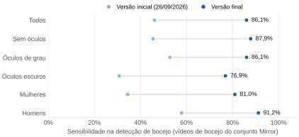

# 4 RESULTADOS E DISCUSSÃO

Este capítulo apresenta os resultados das quatro frentes de avaliação descritas na Seção 3.7: os testes automatizados, o protocolo de testes guiados, a avaliação na base YawDD, com a validação cruzada por participante, e a medição de desempenho no Raspberry Pi 5. Ao final, discutem-se as limitações identificadas.

## 4.1 Testes automatizados e regressão

Os 42 testes automatizados da lógica de decisão foram aprovados na versão final do sistema. Cada um deles corresponde a um comportamento verificado ao longo do desenvolvimento, muitas vezes a partir de uma falha real: o bocejo com os olhos fechados que não pode disparar o alarme de sono, a queda da cabeça que tira o rosto do quadro e ainda assim deve ser contada, a fala e o sorriso que estendem o tempo do alarme. O teste de regressão, executado sobre as séries da rodada final do YawDD e sobre os 80 episódios de alarme registrados nas sessões ao vivo, não apontou piora em nenhum indicador em relação à referência de 30 de setembro. Apenas dois vídeos tiveram contagens alteradas, ambos com bocejos a mais em vídeos que já continham bocejo, efeito do reprocessamento das medidas desde o início. Dos 80 episódios ao vivo, 61 continuam disparando o alarme com as regras atuais, o mesmo número da referência. Como esses episódios foram gravados por versões anteriores do sistema, que tinham falhas corrigidas depois, o teste não exige que todos disparem, e sim que nenhuma mudança reduza esse número sem que se saiba por quê.

## 4.2 Protocolo de testes guiados

O protocolo de oito cenários foi executado doze vezes durante o desenvolvimento, entre 9 e 30 de setembro de 2026, e uma última vez antes da correção da captura descrita na Seção 4.5. A Figura 2 mostra o número de cenários aprovados em cada rodada.

::: Figura 2: cenários aprovados em cada rodada do protocolo de testes guiados

::: Fonte: autoria própria

A evolução não foi monotônica, e as quedas foram tão informativas quanto os avanços. Nas primeiras rodadas, de 9 de setembro, falharam a fala, confundida com bocejo, o microssono, cujo limiar de olho fechado se mostrou rígido demais, e o bocejo real, cujo rastreamento dos lábios falhava por instantes no meio do movimento, interrompendo a contagem. Esses problemas levaram, respectivamente, à exigência de um pico de abertura bem maior que o da fala, ao afrouxamento do limiar de olho fechado e à tolerância a lacunas de rastreamento, com mediana de nove quadros na boca.

A queda para 4 de 8 cenários em 23 de setembro, às 12h19, não decorreu de mudança no código: a calibração daquela rodada registrou EAR de referência de 0,320, contra cerca de 0,24 nas demais, provavelmente por olhos arregalados durante a coleta. Com uma referência inflada, o limiar de olho fechado subiu e piscadas normais passaram a ser contadas como longas. O episódio motivou a comparação de cada calibração com o histórico das anteriores, descrita na Seção 3.3. Já as falhas do cenário da cabeça em 30 de setembro foram diagnosticadas pela telemetria do relatório. Na primeira, uma oscilação de um único quadro reiniciava a contagem da queda, corrigida com a tolerância de 0,5 segundo; na segunda, a queda real tirava o rosto do quadro após 0,3 segundo visível, antes de completar o tempo mínimo. A regra que conta como queda o desaparecimento do rosto logo após a cabeça baixar com os olhos se fechando resolveu o caso, e a rodada seguinte aprovou os oito cenários pela primeira vez.

O cenário dos óculos exigiu uma decisão de projeto. Os únicos óculos escuros disponíveis para o teste tinham lente polarizada, com razão de brilho entre olhos e rosto de 0,60 a 0,67, próxima do limiar de 0,70 e insuficiente para sustentar o modo de óculos por três segundos. Em vez de afrouxar o limiar até o caso de teste passar, o critério do cenário foi redefinido para o comportamento que de fato importa (Quadro 3): o sistema não pode ficar cego sem perceber. Nas rodadas de 30 de setembro, o EAR medido através da lente polarizada caiu para 0,07 a 0,11 com os olhos fechados, bem abaixo do limiar de olho fechado, ou seja, a lente não impediu a detecção.

[[PENDENTE: repetir a rodada final a 30 fps, com a captura corrigida, e descrevê-la aqui; a de 13h46 abaixo ainda era a cerca de 7,7 fps.]] Na rodada de 20 de outubro de 2026 às 13h46, os oito cenários foram aprovados. A calibração registrou EAR de referência de 0,280, próximo ao histórico, o que fixou o limiar de olho fechado em 0,196. Na linha de base, o menor EAR observado foi 0,220, acima desse limiar, enquanto no microssono o EAR chegou a 0,018. Na fala, o MAR não passou de 0,186, abaixo do limiar de sustentação do bocejo (0,40), e no bocejo real chegou a 0,866. No cenário da cabeça, o índice *H* subiu de 0,46, na calibração, para até 0,88, com 3,8 segundos de cabeça baixa e olhos se fechando; e, com os óculos polarizados, o EAR caiu para 0,094 com os olhos fechados. As margens entre os valores observados em cada situação e os limiares de decisão indicam que a aprovação não dependeu de casos no limite.

## 4.3 Avaliação na base YawDD

A rodada final processou os 349 vídeos da base, com calibração válida dos olhos em 348 deles e rosto detectado, em média, em 99,1% dos quadros de cada vídeo. O Quadro 4 compara os resultados da versão inicial do sistema, avaliada em 26 de setembro, com os da versão final.

::: Quadro 4: resultados na base YawDD, versão inicial e versão final

| Medida | Versão inicial (26/09) | Versão final |
|---|---|---|
| Sensibilidade do bocejo (Mirror) | 46,1% (53 de 115) | 86,1% (99 de 115) |
| Precisão do bocejo (Mirror) | 100,0% | 99,0% |
| Medida F1 do bocejo (Mirror) | 63,1% | 92,1% |
| Bocejo falso em vídeos de fala ou de condução normal | 0 de 205 | 1 de 205 |
| Vídeos do Dash com bocejo encontrado | 15 de 29 | 28 de 29 |
| Alarmes de sono (todos falsos) | 76 (28,5 por hora) | 6 (2,3 por hora) |
| Avisos de atenção (todos falsos) | 219 (82,1 por hora) | 19 (7,1 por hora) |

::: Fonte: autoria própria

Na versão final, a sensibilidade do bocejo quase dobrou, de 46,1% para 86,1%, ao custo de um único bocejo falso em 205 vídeos sem bocejo, e os alarmes de sono falsos caíram de 76 para 6, uma redução de 92%. A versão inicial era conservadora na direção errada para o bocejo: não inventava bocejos, com precisão de 100%, mas deixava passar mais da metade deles, e ao mesmo tempo emitia alarmes de sono e avisos de atenção em pessoas que não estavam sonolentas. A análise dos vídeos com erro mostrou causas recorrentes, e cada ajuste descrito no Capítulo 3 responde a uma delas. Bocejos de pico baixo passavam poucos décimos de segundo acima do limiar único de abertura e nunca completavam a duração mínima, o que motivou a histerese entre pico e sustentação. Bocejos com os lábios pouco abertos ou cobertos pela mão quase não alteravam o MAR, o que motivou o segundo caminho, pela mandíbula. Parte das participantes bocejava logo no início do vídeo, dentro da calibração, contaminando a referência, o que motivou o descarte dos quadros de boca aberta. Do lado dos alarmes falsos, os olhos se fechavam ao rir e falar, ao bocejar e logo depois dele, e a cabeça baixava quando o condutor olhava para o painel, situações tratadas pelas regras de fala, sorriso, bocejo e cabeça com olhos se fechando.

::: Figura 3: sensibilidade na detecção de bocejo por grupo de participantes

::: Fonte: autoria própria

A Figura 3 detalha a sensibilidade por grupo. Os maiores ganhos ocorreram justamente nos grupos em que a versão inicial era pior: entre as mulheres, a sensibilidade passou de 34,5% para 81,0%, e entre os participantes de óculos escuros, de 30,8% para 76,9%. A diferença entre mulheres e homens, de 23,4 pontos percentuais na versão inicial, caiu para 10,2 pontos, mas não desapareceu, e os óculos escuros continuam sendo o grupo de menor sensibilidade, além de concentrar o único bocejo falso. Os resultados por grupo devem ser lidos com cautela, porque alguns grupos são pequenos: há apenas 13 vídeos de bocejo com óculos escuros. Os bocejos ainda não detectados concentram-se em casos em que nem os lábios nem a mandíbula se movem o suficiente, como bocejos contidos ou cobertos pela mão, situação que está no limite do que os marcos faciais conseguem observar.

Como os vídeos da YawDD são curtos, com um a dois minutos, as regras baseadas em frequência, como as três piscadas longas em dois minutos e o PERCLOS em janela de 60 segundos com ao menos 30 segundos de histórico, têm pouco tempo para agir. Os alarmes falsos medidos na base refletem, portanto, sobretudo as regras instantâneas.

## 4.4 Validação cruzada por participante

O Quadro 5 compara o desempenho da regra final, ajustada observando todos os vídeos, com o da validação cruzada em cinco dobras de 18 participantes, em que cada vídeo foi avaliado por limiares escolhidos sem ver aquela pessoa.

::: Quadro 5: detecção de bocejo com a regra final e na validação cruzada por participante

| Medida (conjunto Mirror) | Regra final, ajustada em todos os vídeos | Validação cruzada (5 dobras) |
|---|---|---|
| Sensibilidade | 86,1% | 87,8% |
| Precisão | 99,0% | 96,2% |
| Medida F1 | 92,1% | 91,8% |
| Bocejo falso em vídeos de fala ou de condução normal | 1 de 205 (0,5%) | 4 de 205 (2,0%) |

::: Fonte: autoria própria

A medida F1 praticamente não muda entre as duas colunas, o que indica que o ajuste feito na própria base não inflou o resultado de forma relevante: para pessoas que os limiares não viram, o desempenho esperado é equivalente. A diferença está no equilíbrio entre sensibilidade e precisão. Em todas as cinco dobras, a escolha automática preferiu um pico de abertura da boca menor (0,50 em vez de 0,55), que encontra mais bocejos, mas também inventa mais. A regra final mantém o valor mais conservador de propósito, porque um sistema que acusa fadiga quando o condutor apenas conversa tende a ser desligado por ele.

A validação cruzada também mostra quanto o resultado depende das pessoas avaliadas. Com a regra final fixa, a sensibilidade variou de 75,0% a 95,5% entre as cinco dobras, uma amplitude maior que qualquer diferença entre as alternativas de ajuste testadas. Os alarmes falsos se concentraram da mesma forma: dos 6 alarmes de sono e 19 avisos de atenção emitidos pela regra final, 5 alarmes e 12 avisos ocorreram em uma única dobra, ou seja, em um mesmo grupo de 18 participantes.

## 4.5 Desempenho no Raspberry Pi 5

O teste de resistência processou um vídeo da YawDD na maior velocidade possível por 20 minutos contínuos, num total de 44.253 quadros, com o rosto detectado em todos eles. O Quadro 6 resume o resultado, e a Figura 4 mostra a taxa de quadros e a temperatura ao longo do teste.

::: Quadro 6: desempenho no teste de resistência de 20 minutos

| Medida | Resultado |
|---|---|
| Taxa de quadros | média de 36,9 por segundo (mínima de 34,0 em intervalos de 10 s) |
| Tempo por quadro, só o MediaPipe | média de 23,2 ms; 95% abaixo de 24,9 ms; 99% abaixo de 26,7 ms |
| Tempo por quadro completo, até a decisão | média de 24,6 ms; 95% abaixo de 26,5 ms; 99% abaixo de 28,6 ms |
| Uso do processador | média de 30%, máximo de 38% |
| Temperatura | 57,3 °C no início, máxima de 60,0 °C, 59,5 °C no fim |
| Frequência do processador | 2,4 GHz durante todo o teste |

::: Fonte: autoria própria

O desempenho se manteve estável do início ao fim: a temperatura se estabilizou em torno de 60 °C nos primeiros minutos, bem abaixo da faixa em que o processador reduz a frequência, que permaneceu em 2,4 GHz. A duração de 20 minutos foi suficiente por esse motivo: nas medições anteriores, a temperatura já se estabilizava entre 3 e 5 minutos, e a partir daí o comportamento não mudava. O quadro mais lento levou 129,8 ms, caso isolado, já que 99% dos quadros ficaram abaixo de 28,6 ms. Da média de 24,6 ms por quadro, 23,2 ms correspondem ao MediaPipe, executado em C++; a lógica escrita em Python, das medidas à decisão, responde por cerca de 1,4 ms, aproximadamente 6% do tempo.

::: Figura 4: taxa de quadros e temperatura no teste de resistência de 20 minutos

::: Fonte: autoria própria

O processamento, portanto, comporta com folga os 30 quadros por segundo com que a câmera opera ao vivo. A preparação destas medições revelou, porém, uma falha na versão anterior da captura: as imagens para a inferência e para a tela eram obtidas em duas leituras sucessivas, cada uma à espera de um quadro novo, o que descartava metade dos quadros. Somada ao modo de resolução máxima então usado, de 15,6 quadros por segundo, a falha limitava o sistema ao vivo a cerca de 7 a 8 quadros por segundo, valor confirmado pelos registros das sessões gravadas. Com a captura corrigida e o modo de 1296 × 972 pixels, a câmera passou a entregar 30 quadros por segundo, a mesma taxa dos vídeos da YawDD, de modo que as janelas de suavização, contadas em quadros, passaram a ter ao vivo a mesma duração que tiveram na avaliação. Nessa taxa, a mediana de três quadros usada no EAR acrescenta cerca de um quadro (33 ms) ao tempo de 1,5 segundo exigido para o alarme de sono, e o processamento de cada quadro, outras poucas dezenas de milissegundos, atrasos desprezíveis diante do tempo de reação humano.

O registro de energia do Raspberry Pi, no entanto, indicou subtensão e redução de velocidade desde a inicialização. A placa exige fonte de 5 V e até 5 A²⁵, e a fonte usada no desenvolvimento não atendia plenamente a essa especificação. Embora a frequência do processador tenha permanecido em 2,4 GHz durante as medições, a instalação no veículo requer uma fonte dimensionada para a placa, já que a tensão de um sistema automotivo varia com a partida do motor e com a carga elétrica.

## 4.6 Limitações

Os resultados devem ser lidos à luz de algumas limitações. A primeira, e mais importante, é que nenhuma das avaliações envolveu sonolência real: no protocolo guiado, os autores simularam os fechamentos de olhos, os bocejos e as quedas de cabeça, e na YawDD os participantes estavam despertos. A detecção de microssono foi validada, portanto, pelo comportamento do sistema diante de fechamentos simulados com a duração característica, e não por episódios espontâneos. A validação com condutores efetivamente sonolentos exigiria uma base como a NTHU-DDD, cujo acesso depende de termo assinado pela instituição, ou um protocolo próprio de privação de sono, com aprovação de comitê de ética.

A segunda limitação é a iluminação. A câmera utilizada não enxerga no infravermelho, o que restringe o uso noturno, justamente o período de maior risco segundo os dados da PRF³. Lentes escuras, por sua vez, impedem a medição do EAR, e nesse caso o sistema depende apenas da boca e da cabeça. A solução prevista é uma câmera sem filtro infravermelho com iluminação ativa em 850 nm, recurso empregado para contornar a limitação noturna dos sistemas baseados em câmera²⁰; seu comportamento diante de lentes escuras ainda precisa ser verificado.

A terceira refere-se aos parâmetros do bocejo, ajustados com a própria base em que foram medidos, limitação mitigada pela validação cruzada por participante (Seção 4.4), mas que só será eliminada com uma base independente. Por fim, os testes ao vivo foram realizados por poucas pessoas, em um único veículo e com uma única posição de câmera; diferenças de montagem, de altura do condutor e de iluminação de outros veículos ainda precisam ser avaliadas.

---

## Observações para revisão (não fazem parte do texto)

- **Rascunho em andamento:** os trechos marcados com `[[...]]` dependem da fila de medições de 20/10 (YawDD completo, regressão, validação cruzada e teste de resistência) e da rodada final do autoteste. Serão preenchidos assim que esses resultados saírem.
- **Figuras 2, 3 e 4:** geradas por `figuras_cap4.py` a partir dos arquivos de resultado; rodar de novo depois de cada medição. A Figura 3 e a Figura 4 ainda mostram dados de prévia (YawDD de 30/09 e benchmark de 1 min de 30/09).
- **Infravermelho e óculos escuros:** a frase da Seção 4.6 só afirma o uso noturno do infravermelho (o que a referência 20 diz); o efeito sobre lentes escuras ficou como algo a verificar, sem citação.
